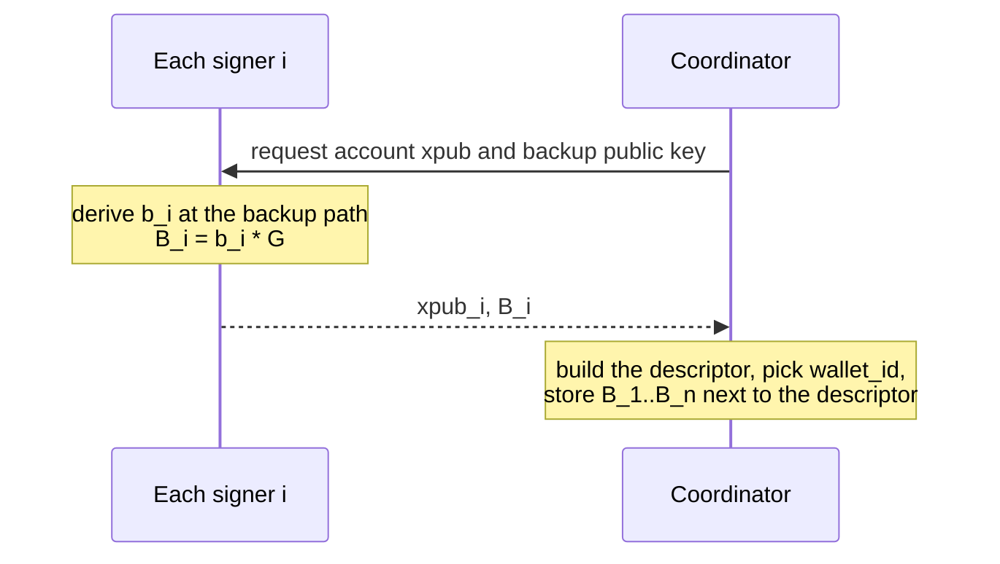
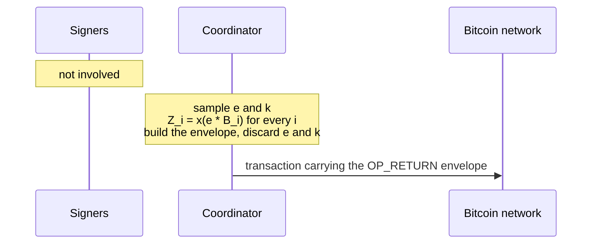
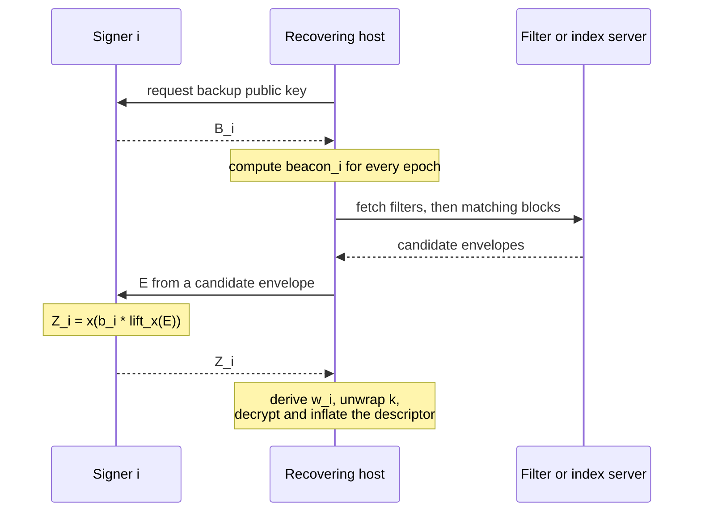
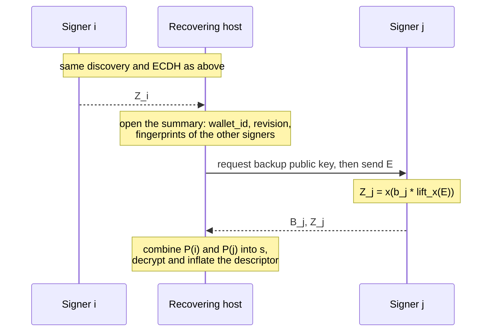

# On-chain encrypted descriptor backups: v4 experiment

Status: design proposal, 2026-11-10. No BIP number or derivation purpose is
assigned by this document. The implementation, with independent vectors, is
[`walletbackup`](../walletbackup/README.md).
[V3](bip-opreturn-backup-v3.md) remains the reference for the review of v2
and for every limitation not restated here.

## Goal

A user whose signing device is part of a multisig wallet, either one person
with devices from several vendors or several people, wants to restore the
wallet descriptor from the chain, ideally without any interaction with the
other signers.

Two priorities order every decision below:

1. **Safety first.** The ciphertext is public forever and can never be
   deleted. Nothing short of the participants' backup private keys may decrypt
   it, today or later.
2. **No interaction, where affordable.** Recovering with one device and nobody
   else is strongly preferred but negotiable. The user decides how much
   descriptor confidentiality to trade for it.

## What changes from v3

V4 narrows the scope and uses the room that creates to shrink the envelope.
The public-key encryption model, the dedicated hardened backup key per seed,
the fresh ephemeral key per publication and the beacon discovery are kept.

| Topic | v3 | v4 |
| --- | --- | --- |
| Participants | up to 16 | up to 5 |
| Recovery threshold `r` | `1..n`, encrypted | `1` or `2`, chosen by the user, public |
| Beacon area | 16 fixed slots with filler, shuffled | 5 fixed slots at offset 0, beacons in canonical key order, filler after |
| Header | 115 bytes | 53 bytes |
| AEAD nonce | 12 random bytes in the header | fixed; every key is used once |
| Publication epoch | in the header | implied by the matching beacon |
| Ephemeral point | 33-byte compressed | 32-byte x-only |
| Summary key wrap | 32 bytes per participant | 16 bytes per participant |
| Shamir shares | sampled polynomial, 32-byte correction for everyone | line through two derived shares, corrections only for participants 3 to `n` |
| Summary | 112 bytes, always present | `20 + 4n` bytes, only for `r = 2` |
| Payload | opaque bytes | descriptor string with binary extended keys, DEFLATE with a preset dictionary |
| 2-of-3 envelope before payload | 451 bytes | 197 bytes |

### The two recovery profiles

* **`r = 1`, single-device recovery.** Any one backup private key opens the
  descriptor. No interaction with anyone. One compromised seed reveals the
  complete descriptor, permanently.
* **`r = 2`, two-device recovery.** One key opens only a small summary that
  says which wallet this is and which other devices exist. Any two keys open
  the descriptor. One compromised seed reveals the summary and nothing else.

`r = 2` is offered regardless of the spending threshold. It is a
confidentiality setting, not a copy of the spending policy. For a wallet that
a single key can spend, `r = 1` is the only setting under which every spending
set can also recover; see v3, "Threshold recovery is a policy choice".

## Who does what, and when

There are three moments. The signing devices take part in the first and the
last, never in publication.

### Setup, once per wallet



This is the only time a device is asked for anything before recovery. `B_i`
travels and is stored exactly like the account xpub.

### Publication, coordinator alone



The coordinator computes every `Z_i` itself, from its own ephemeral secret and
the stored public keys. No backup private key is used.

The transaction still has to be funded. Paying from the multisig wallet itself
needs an ordinary signing round, which involves the spending keys but not the
backup keys. Paying from any other wallet involves no signer at all.

### Recovery with `r = 1`, one device



This is the first and only time the backup private key is used. Nobody else is
contacted.

### Recovery with `r = 2`, two devices



If signer `j` belongs to another person, that person runs the same steps on
their own host and hands over `P(j)` for this publication. That hand-over is
the one interaction `r = 2` requires, and its transport is not yet specified.

## Specification

### Keys and parameters

Each seed has a dedicated backup key pair `(b, B)`, separated from spending
keys by hardened BIP32 derivation. The path is not assigned here. `B` is a
valid 33-byte compressed secp256k1 point.

Sort the distinct `B` values lexicographically. Their one-based positions are
the participant indexes `1..n`, with `1 <= n <= 5`. The threshold is `r = 1`,
or `r = 2` with `n >= 2`.

`network` is the chain's 32-byte genesis hash in wire byte order.
`epoch = floor(construction_tip_height / 2016)` as a `uint32`.

### Notation

`T(label, parts...)` is BIP340 tagged SHA256 with the tag
`btcd/walletbackup/v4-experiment/` followed by `label`. `||` is byte
concatenation. Integers are fixed-width big-endian. Scalar arithmetic is
modulo the secp256k1 group order `N`. `ZERO12` is twelve zero bytes.

Each publication samples, from a secure random source:

1. A nonzero scalar `e` uniformly in `[1, N-1]`. If `eG` has an odd Y
   coordinate, replace `e` with `N - e`. `E` is the 32-byte X coordinate.
2. One 16-byte key seed `k`.
3. Four bytes of filler for each unused beacon slot.

Nothing else is random. To retransmit, reuse the envelope bytes. Rebuilding
samples new values even for an identical wallet.

### Header

| Offset | Size | Meaning |
| ---: | ---: | --- |
| 0 | 20 | Five beacon slots. Slot `i` holds `beacon_i` for `i <= n`; the remaining slots hold random filler |
| 20 | 1 | Format byte `0x40 \| ((r-1) << 3) \| n` |
| 21 | 32 | Ephemeral point `E`, x-only |

```
beacon_i = T("beacon", network || B_i || uint32(epoch))[0:4]
context  = T("context", network || uint32(epoch) || header)
```

The format byte is `0x41..0x45` for `r = 1` and `0x4A..0x4D` for `r = 2`.
Every other value is rejected. The high nibble is simply the version number.

The beacon area comes first and has a fixed size so that every beacon sits
on a four-byte boundary at a known offset, whatever `n` is. A filter or a
scanning server indexes those five chunks without parsing anything.

Beacon *values* are hash outputs, so listing them in key order exposes no
ordering to an observer who does not hold the public keys. A reader's own
index is the slot in which its beacon appears.

The epoch is not transmitted. It is bound through `context`, so a reader that
assumes the wrong epoch fails authentication.

### Per-participant key material

```
Z_i        = x(e * B_i) = x(b_i * lift_x(E))
material_i = HKDF-SHA256(
    IKM  = Z_i,
    salt = context,
    info = UTF8("btcd/walletbackup/v4-experiment/recipient/") || B_i || byte(i),
    L    = 48
)
w_i        = material_i[0:16]
h_i        = int(material_i[16:48]) mod N
```

`lift_x` selects the even-Y point as in BIP340. The X coordinate of the ECDH
result does not depend on that choice. `h_i` is unused for `r = 1`.

### Profile `r = 1`

```
wrap_i     = k XOR w_i                              (16 bytes)
entries    = wrap_1 || ... || wrap_n
K2         = T("content-key", context || k)
content_ct = ChaCha20Poly1305(K2).Seal(ZERO12, payload, context || entries)
envelope   = header || entries || content_ct
```

Size: `69 + 16n + len(payload)` bytes.

### Profile `r = 2`

The summary key is transported exactly like the content key above:

```
wrap_i = k XOR w_i                                  (16 bytes)
K1     = T("summary-key", context || k)
```

The content secret is shared with a line `P(x) = s + a*x` that is *defined* by
the first two participants' derived values instead of being sampled:

```
P(1) = h_1
P(2) = h_2
a    = h_2 - h_1                    mod N
s    = P(0) = 2*h_1 - h_2           mod N
P(i) = h_1 + (i-1)*a                mod N
d_i  = P(i) - h_i                   mod N          for i = 3..n (32 bytes)
```

If `a = 0`, discard everything sampled and start the publication again. This
happens with negligible probability and would make the line constant.

Participants 1 and 2 need no stored share. Only participants 3 to `n` get a
correction.

```
entries     = wrap_1 || ... || wrap_n || d_3 || ... || d_n
summary     = wallet_id(16) || uint32(revision) || fingerprint_1 || ... || fingerprint_n
summary_aad = context || entries
summary_ct  = ChaCha20Poly1305(K1).Seal(ZERO12, summary, summary_aad)
K2          = T("content-key", context || scalar32(s))
content_ct  = ChaCha20Poly1305(K2).Seal(ZERO12, payload, summary_aad || summary_ct)
envelope    = header || entries || summary_ct || content_ct
```

`wallet_id` is a random nonzero 16-byte value assigned once per wallet
instance and kept across revisions. Each fingerprint is a four-byte BIP32
master fingerprint used only as a display hint; zero omits it.

Size: `41 + 52n + len(payload)` bytes.

### Envelope sizes before payload

| `n` | `r = 1` | `r = 2` | v3 |
| ---: | ---: | ---: | ---: |
| 1 | 85 | n/a | 323 |
| 2 | 101 | 145 | 387 |
| 3 | 117 | 197 | 451 |
| 4 | 133 | 249 | 515 |
| 5 | 149 | 301 | 579 |

### Payload

The payload is the wallet's output descriptor, encoded in three steps.

1. **Start from the BIP 380 string**, without the `#checksum` suffix. The AEAD
   already authenticates the bytes.
2. **Replace every extended public key.** Wherever a base58 `xpub` or `tpub`
   appears, write one `0x00` byte followed by the 78 bytes that the base58check
   string decodes to (version through public key, without the checksum).
   Everything else stays as it is. A descriptor string never contains `0x00`,
   so the marker is unambiguous.
3. **Compress** with raw DEFLATE (RFC 1951, no gzip or zlib framing), using
   the preset dictionary below.

A reader inflates with the same dictionary, then turns each `0x00` marker and
the 78 bytes after it back into a base58check string.

* Private keys are forbidden. A reader MUST reject an extended key with a
  private version and any other private key in the descriptor. The
  implementation rejects extended private keys and WIF keys by pattern; it
  does not parse the descriptor.
* The compressed payload is at most 4096 bytes and inflates to at most 8192
  bytes. A reader MUST stop inflating at that bound. Both limits are
  placeholders.
* The compressor's settings are not specified; a reader only needs to inflate.

There is no padding, so the envelope length reveals the approximate length of
the descriptor.

#### Preset dictionary

The dictionary is 462 bytes of common descriptor fragments: script and
miniscript function names, standard origin paths in both `'` and `h`
notation, the BIP 341 unspendable internal key, and the byte patterns that
surround a substituted extended key. More likely fragments sit nearer the end.
Its SHA256 is
`77f58b334526d83a20d8a10ec10b197d486f20f8945ae3e9b00a10dbd892487b`.

```
726970656d643136302868617368313630286861736832353628736861323536
28616e646f7228616e645f6228616e645f6e286f725f62286f725f63286f725f
69286f725f6428616e645f7628763a706b28746872657368286166746572286f
6c64657228706b5f6828706b5f6b28706b682873682877706b68286d75736967
286d756c74695f6128736f727465646d756c74695f61286d756c7469282f3434
682f3439682f3435682f3837682f31682f30685d2f3834682f30682f30685d2f
3836682f30682f30685d2f3438682f31682f30682f32685d2f3438682f30682f
30682f32685d2f3434272f3439272f3435272f3837272f31272f30275d2f3834
272f30272f30275d2f3836272f30272f30275d2f3438272f31272f30272f3227
5d2f3438272f30272f30272f32275d2f302f2a2f312f2a297472283530393239
6237346331613034393534623738623462363033356539376135653037386135
6130663238656339366435343762666565396163653830336163302c7b800000
0080000001800000025d00043587cf035d00043587cf045d000488b21e035d00
0488b21e042f3c303b313e2f2a29292c5b2f3c303b313e2f2a2c5b7773682873
6f727465646d756c746928322c5b
```

This is a first cut built from the descriptor shapes below, not from a corpus
of real wallets. It should be recalibrated before the format is frozen.

#### Measured payload sizes

Averages over 100 descriptors per shape with random keys and fingerprints:

| Descriptor | Characters | Plain DEFLATE | Binary keys | Binary keys and dictionary |
| --- | ---: | ---: | ---: | ---: |
| `wsh(sortedmulti)` 2-of-3 | 448 | 346 | 309 | 268 |
| `wsh(sortedmulti)` 3-of-5 | 734 | 524 | 482 | 445 |
| `tr` with unspendable key, `sortedmulti_a` 2-of-3 | 514 | 394 | 374 | 273 |
| `wsh` miniscript, 2-of-3 or timelocked fourth key | 618 | 457 | 421 | 375 |
| `wpkh` single key | 145 | 141 | 116 | 95 |
| `wsh(multi)` 2-of-3, unusual account, `/0/*` | 430 | 335 | 302 | 276 |

Three extended keys and their fingerprints are 246 bytes of incompressible
data, so the 2-of-3 result is within about 22 bytes of the floor. A complete
2-of-3 backup is 385 bytes with `r = 1` and 465 bytes with `r = 2`.

### Recovery

1. **Discover.** For a block at height `H`, compute the reader's beacon for
   epoch `floor(H / 2016)` and for the preceding epoch (omit the latter at
   epoch zero). Query the filter, fetch matching blocks, and take every
   candidate output together with the epoch whose beacon matched.
2. **Parse.** Check the format byte and the exact minimum length for its `n`
   and `r`. Reject an `E` that is not a valid X coordinate, and any `d_i >= N`.
3. **Find the index.** Every slot `i <= n` in which the reader's beacon appears
   is a candidate index. Compute `Z` once, then `material_i` per candidate.
4. **`r = 1`:** unwrap `k`, derive `K2`, open the payload. Done.
5. **`r = 2`:** unwrap `k`, derive `K1`, open the summary. Show it as a
   recovery candidate. The reader's share is `P(i) = h_i` for `i <= 2` and
   `P(i) = d_i + h_i` otherwise.
6. **Combine.** Bind each share to
   `T("publication", network || uint32(epoch) || envelope)` and never combine
   shares from different publications. With shares at distinct indexes `i`
   and `j`:

   ```
   s = P(i) * j/(j-i) + P(j) * i/(i-j)   mod N
   ```

   Derive `K2` and open the payload.
7. **Validate.** Inflate within the bound, restore the extended keys, parse
   the descriptor, check that
   the device's own keys appear in it, and keep every conflicting candidate.
   Decryption is not approval; see below.

## Security notes specific to v4

### Derived shares

V3 sampled the content secret and the polynomial independently, explicitly to
avoid a new security argument. V4 accepts that argument to save two share
slots. It rests on one assumption the masking already needs: the HKDF outputs
`h_i` of different participants are pseudorandom and independent to anyone
who cannot compute the corresponding `Z_i`.

* **Outsider.** Sees only `d_i = P(i) - h_i` for `i >= 3`, each masked by an
  unknown `h_i`.
* **Participant 1 or 2 alone.** Knows one of `h_1`, `h_2`. Since
  `s = 2*h_1 - h_2`, the other value still hides `s` completely. The
  corrections of other participants stay masked.
* **Participant `j >= 3` alone.** Learns `P(j) = (2-j)*h_1 + (j-1)*h_2`. The
  pair `(P(j), s)` is an invertible linear map of `(h_1, h_2)` (determinant
  `-j`, nonzero modulo `N`), so `s` remains uniform given `P(j)`.
* **Bias.** Reducing a 256-bit HKDF output modulo `N` has bias below `2^-127`.
  Zero is a valid share.
* **Tampering.** Participants 1 and 2 have no stored share to corrupt. The
  corrections for the others are bound by both AEADs.

The layout is asymmetric: whether a correction exists depends on a
participant's position in the sorted key order. That position carries no
privilege. Any two participants recover, and any one learns only the summary.

### Fixed nonce and 128-bit seeds

Each AEAD key is derived from fresh randomness and `context`, and is used for
exactly one message, so a constant nonce is safe. This holds only as long as
an envelope is never rebuilt with reused randomness.

The transported seed `k` is 128 bits, matching the security level of
secp256k1. Deriving the AEAD keys through `context` separates publications and
prevents multi-target shortcuts.

### What v4 gives up relative to v3

* The threshold `r` is public. It was encrypted in v3.
* The wallet ID is 128 bits and the revision 32 bits.
* The content secret is no longer an independent sample.
* There is no `r = 1` summary; the descriptor is the only content.

### Carried over unchanged from v3

* **Forgery.** Anyone with the backup public keys can publish a convincing
  backup. Never select a wallet for receiving funds on decryption alone.
* **Tracking.** The backup public keys locate a wallet's publications. The
  format is openly recognisable and makes no hiding claim.
* **Correct dealing.** A faulty publisher can produce a summary that opens and
  a payload that does not. This is detected only at recovery.
* **Seed entropy.** There is no key stretching.
* **Publisher secrets.** The publisher knows everything while building the
  envelope and must discard `e` and `k`.
* **Filter completeness.** A filter-header chain does not prove that a
  provider served every backup.

## Discovery filter

The filter element set is the first five aligned four-byte chunks of an
OP_RETURN output's concatenated push data, where complete. A filter that
indexes more chunks, for example the first eight or sixteen, also works; the
extra elements are harmless. A server that can scan OP_RETURN outputs for a
four-byte value at those offsets is an equivalent discovery mechanism. The remaining index questions and the false-positive estimates in
v3 apply unchanged.

Every envelope still exceeds the 80-byte data carrier limit in
[`txscript/standard.go`](../txscript/standard.go). Publication needs the relay
and miner plan discussed in v3.

## Open questions

* **Dictionary.** Recalibrate against real descriptors. Brotli was the
  alternative to DEFLATE; its built-in dictionary targets web text and it
  would add a dependency.
* **Secret beacons.** Each device could export
  `beacon_id = x(b_i * lift_x(H))` at setup, with `H` the BIP 341 point, and
  beacons would be derived from that instead of `B_i`. The backup public key
  alone would then no longer locate publications. The coordinator stores both
  values side by side, so the gain is small; it is a one-line change that can
  be added later.
* **Share transport for `r = 2` between people.** Still undefined. It decides
  how much interaction the two-device profile really costs.
* **Device interface.** The device must export `B` and compute `x(b*E)`.
  Whether it also runs the KDF and releases only `w_i` and `P(i)` is open.
* **Approval signatures, verifiable dealing, birth height.** As in v3.
* **Payload limits.** The 4096 and 8192 byte bounds need real descriptors to
  calibrate.
